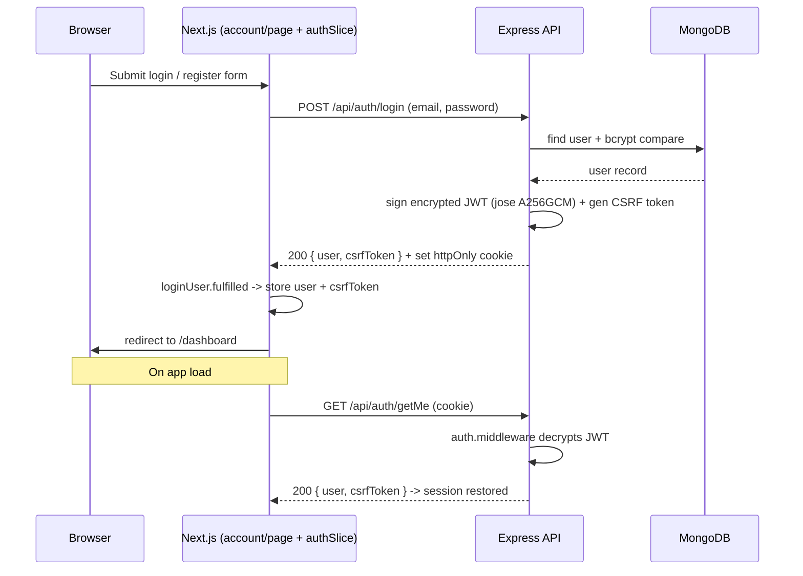

# GroupHub — Project Architecture & Technical Overview

> **Version 1.0** · Maintained by **Aman**
> Tagline: *Collaborate Intelligently. Build Seamlessly.*
> Purpose: a quick, accurate map of what GroupHub is, how it is built, what works today, and what comes next — for new developers and mentors.

---

## 1. Purpose & Problem

### The Problem
Students, developers, and creators have project ideas but struggle to find teammates with **complementary skills**. Existing platforms (LinkedIn, Behance, GitHub) are passive portfolios — they show *who you are*, not *what a project needs*. Joining a team is awkward, slow, and opaque.

A - person with skills
B - person with ideas
(vice versa)

grouphub closes the gap between them

### The Solution
GroupHub is a **project-first collaboration platform**. Instead of browsing profiles, users browse **open roles inside projects**:

- Users post project ideas with explicit open roles (e.g. "React frontend dev", "UX designer").
- Contributors discover projects by **category, skill, and role**.
- Project pages surface **roles, stage, commitment, team size, and skill fit** *before* anyone applies.
- A **reputation / leaderboard** system gamifies contributions.

### Key Differentiator
**Role-first matching.** You are not browsing "projects" — you are browsing "frontend roles," "design roles," etc. This removes friction: you know immediately whether there is a spot for your skill set.

### Target User
Students and early-career professionals who want to build real portfolio projects with teams rather than working alone.

---

## 2. Development Status Summary

> **Important context.** This repository was recently the subject of a full rewrite. The last commit on `main` (`3713614`, *"full codebase refactor, creating backend from scratch"*) **deleted a complete previous full-stack implementation** (chat, file manager, Cloudinary uploads, email verification, password reset, matchmaking, notifications, blogs, leaderboard) and started clean. The features shown in git history are **planned for re-addition**, not currently live.

| Layer | Status |
|-------|--------|
| Frontend UI shell & marketing pages | ✅ Implemented (hardcoded data) |
| Frontend auth UI + Redux wiring | ✅ Implemented |
| Backend authentication API | ✅ Implemented |
| Backend profile endpoint | 🟡 Stub (empty file) |
| Project / discovery / applications / leaderboard | 🔵 Planned (frontend only, hardcoded) |
| Chat, file manager, email, AI, matchmaking | 🔵 Planned (previously built, removed in refactor) |

**Legend:** ✅ = implemented · 🟡 = in progress / stub · 🔵 = planned · ⛔ = blocked

---

## 3. System Architecture

GroupHub is a **monorepo** with two top-level packages: `backend/` (Express REST API) and `frontend/` (Next.js App Router).

### High-level diagram

```mermaid
flowchart TD
    U[Browser] --> F[Next.js Frontend<br/>:3000]

    subgraph F [Frontend - Next.js 16 App Router]
        P1[Home / About / Contact]
        P2[Contribute / Leaderboard / Tutorials]
        P3[Find Projects]
        P4[Dashboard / Profile]
        P5[Account - Login / Register]
    end

    P1 & P2 --> D1[lib/data/*.js<br/>Hardcoded demo data]
    P3 & P4 --> L1[React local state]

    P5 --> AUTH[Redux authSlice]
    AUTH --> API[lib/api.js<br/>fetch wrapper]
    API --> B

    subgraph B [Backend - Express :8762]
        R1[/api/auth Router]
        R1 --> C1[auth.controller]
        C1 --> M1[User Model]
        M1 --> DB[(MongoDB Atlas)]
        MW[auth + CSRF middleware] --> R1
    end

    style DB fill:#0b3d2e,color:#fff
```

### Plain-ASCII fallback

```
┌────────────────────────────── Browser ──────────────────────────────┐
│                                                                     │
│   Next.js Frontend (:3000)   ── Redux (authSlice) ── lib/api.js     │
│   │   Pages: home, about, contact, contribute, leaderboard,         │
│   │          tutorials, find-projects, dashboard, profile, account  │
│   │   Data: lib/data/*.js (hardcoded)  ·  Local state (filters/save)│
└────────────────────────────────┬────────────────────────────────────┘
                                 │  HTTP + credentials(include)
                                 │  X-CSRF-Token header on mutations
                                 ▼
┌────────────────────────────── Express API (:8762) ──────────────────┐
│   cors · cookie-parser · logging                                    │
│   /api/auth ── auth.middleware (JWT decrypt) ── csrf.middleware      │
│        └── auth.controller ── User model ── MongoDB (Mongoose)      │
└─────────────────────────────────────────────────────────────────────┘
```

### Key integration notes
- The frontend uses `credentials: 'include'` and reads the auth session from an **httpOnly cookie**.
- Mutating requests (logout) send the **CSRF token** back in the `X-CSRF-Token` header; the backend compares it to a token embedded inside the encrypted JWT.
- Frontend base URL defaults to `http://localhost:8762` (overridable via `NEXT_PUBLIC_API_URL`).

---

## 4. Component Responsibilities

### Backend (`backend/`)
| Path | Responsibility |
|------|----------------|
| `server.js` | Express bootstrap, middleware wiring (CORS, cookie-parser, logging), mounts `/api/auth`, connects to MongoDB. |
| `config/db.js` | Mongoose connection using `MONGODB_URI`; exits process on failure. |
| `models/User.model.js` | User schema: `name`, `email` (unique, lowercased), `password` (bcrypt, `select:false`), `role` (`user`/`admin`), timestamps. |
| `controllers/auth.controller.js` | `register`, `login`, `logout`, `getMe`. Login produces an **encrypted JWT** (jose `A256GCM`) stored as an httpOnly cookie, and returns a CSRF token. |
| `middleware/auth.middleware.js` | `authenticateToken` — decrypts the access cookie into `req.user`. |
| `middleware/csrf.middleware.js` | `verifyCsrfToken` — validates `X-CSRF-Token` header against the token carried in the JWT for `POST/PUT/PATCH/DELETE`. |
| `routes/auth.routes.js` | Endpoint definitions for the auth domain. |
| `controllers/profile.controller.js` | 🟡 **Empty stub** — profile logic not yet implemented. |
| `utils/endpoints.util.js` | 🟡 **Empty stub** — placeholder utility module. |

### Frontend (`frontend/`)
| Path | Responsibility |
|------|----------------|
| `app/layout.jsx` | Root layout: Geist fonts, `globals.css`, Redux `Providers`, `Navbar`, `Footer`, Vercel Analytics (prod only). |
| `app/providers.jsx` | Wraps children in the Redux `<Provider store={store} />`. |
| `app/account/page.jsx` | Auth UI — login/register form, dispatches `loginUser` / `registerUser`, redirects to `/dashboard`. |
| `app/profile/page.jsx` | View/edit profile — **UI only**, explicitly notes backend is not wired. |
| `app/dashboard/page.jsx` | Workspace (stats, projects, applications, activity, new-project modal) — hardcoded local data. |
| `app/find-projects/page.jsx` | Project discovery: search, category/skill filters, save/bookmark — all local state. |
| `app/leaderboard/page.jsx` | Top contributors + stats — hardcoded data. |
| `app/contribute/page.jsx` | Contribution types + featured projects — hardcoded data. |
| `app/tutorials/page.jsx` | Tutorial grid — hardcoded data. |
| `app/about/page.jsx` | Mission, values, team (demo data). |
| `app/contact/page.jsx` | Contact form (local success state) + FAQ. |
| `app/page.jsx` | Landing / hero. |
| `components/navbar.jsx` | Global nav; **dispatches `fetchMe()` on mount** to restore session; auth-aware links; mobile drawer. |
| `components/footer.jsx` | Multi-column footer with link groups. |
| `components/page-header.jsx`, `section.jsx`, `eyebrow.jsx`, `stat-tile.jsx`, `field.jsx`, `avatar.jsx` | Small custom product primitives (replaced the deleted shadcn set). |
| `lib/store.js` | Redux `configureStore` with `auth` reducer. |
| `lib/features/auth/authSlice.js` | Thunks (`registerUser`, `loginUser`, `logoutUser`, `fetchMe`) + reducer state (`user`, `csrfToken`, `status`, `initialized`, `error`). |
| `lib/api.js` | `fetch` wrapper — JSON body, `credentials:'include'`, CSRF header. |
| `lib/data/*.js` | Hardcoded demo data for each marketing/app page. |
| `lib/utils.js` | `cn()` (clsx + tailwind-merge) and `getInitials()`. |
| `app/globals.css` | Active stylesheet: warm-neutral brand palette tokens + dark-first OKLCH primitive layer. |

> Note: the previous 57-file `components/ui/*` shadcn set was removed in the refactor and is preserved only as `components-ui-backup.zip` at the repo root.

---

## 5. End-to-End Execution Flow

### A. Authentication flow (fully implemented)


### B. Session restore on page load
1. `Navbar` mounts.
2. If `state.auth.initialized === false`, it dispatches `fetchMe()`.
3. `fetchMe` calls `GET /api/auth/getMe` with the httpOnly cookie.
4. On success, `user` + `csrfToken` populate Redux; the navbar switches from "Account/Dashboard" links to "Hi, {name} / Dashboard / Log out".
5. On failure, the user stays logged-out.

### C. Logout flow
1. User clicks **Log out** (desktop or mobile menu).
2. `logoutUser` dispatches → `POST /api/auth/logout` with `X-CSRF-Token` from Redux.
3. Backend runs `authenticateToken` → `verifyCsrfToken` → clears the cookie.
4. Redux clears `user`/`csrfToken`; router pushes to `/`.

---

## 6. Current Development Status

### ✅ Implemented
| Area | Details |
|------|---------|
| **Frontend shell & design system** | Next.js App Router, global navbar/footer, responsive layout, tokenized warm-neutral palette. |
| **All marketing/info pages** | Home, About, Contact, Contribute, Leaderboard, Tutorials — rendered from hardcoded `lib/data/*.js`. |
| **Find Projects** | Search + category + skill filtering, save/bookmark toggle — **local state only**. |
| **Dashboard** | Stats, project cards, applications, activity feed, new-project modal — **local state only**. |
| **Account (auth UI)** | Login/register with validation (password match, min 8 chars client+server). |
| **Backend auth API** | `register`, `login`, `logout`, `getMe` with encrypted JWT cookie + CSRF. |
| **Session persistence** | Auto-restore via `fetchMe` in navbar; cookie-based. |
| **Profile page** | View + edit form — **UI only, not wired to backend**. |

### 🟡 In progress / stubs
| Area | Details |
|------|---------|
| Backend profile endpoint | `profile.controller.js` is an empty file; no `/profile` route beyond an inline auth check. |
| Backend utilities | `utils/endpoints.util.js` is empty. |
| Backend commit status | Entire `backend/` directory is currently **untracked** in git (not yet committed). |

### 🔵 Planned (previously built in the pre-refactor codebase, to be re-added)
| Feature | Prior implementation reference |
|---------|-------------------------------|
| Project CRUD, roles, tasks, progress | Was in `app/projects/[id]/manage/page.jsx` + `project/task/role` controllers. |
| Applications & membership | `application`, `membership` controllers. |
| Real project discovery / matchmaking | `matchmaking` controller + `matchmaking queries` (M-07). |
| Leaderboard & reputation | `leaderboard.controller.js`. |
| Notifications & activity feed | `notification`, `activity` controllers + `ActivityEvent` model. |
| Email verification & password reset | Was in `verify-email`, `forgot-password`, `reset-password` pages. |
| Real-time chat | socket.io + chat models/services/handlers + inbox page. |
| File manager + Cloudinary uploads | Cloudinary config, upload middleware, storage bars. |
| AI features (tagging, description rewriting) | Commits `d88ea5e` (AI tagging/rewriting). |
| Blogs / tutorials content system | Blog posts under `documents/blogs/` convention. |

### ⛔ Blocked
| Item | Reason |
|------|--------|
| None currently flagged | — |

---

## 7. Technology Stack

### Frontend
| Technology | Version | Role |
|------------|---------|------|
| Next.js | 16.2.4 | App Router, file-based routing, React Server Components |
| React | 19 | UI library |
| Tailwind CSS | 4.2 | CSS-first config via `@tailwindcss/postcss` |
| Redux Toolkit + React-Redux | ^2.13 / ^9.3 | Global state (auth) |
| lucide-react | ^0.564 | Icons |
| class-variance-authority / clsx / tailwind-merge | — | `cn()` class merging |
| tw-animate-css | 1.3.3 | Animation utilities |
| recharts | 2.15.0 | Charts (installed; for future dashboard analytics) |
| embla-carousel-react, vaul, cmdk, date-fns, sonner, react-hook-form, zod, next-themes | — | Utility/interaction libs (available for future features) |
| @vercel/analytics | 1.6.1 | Production-only analytics |

### Backend
| Technology | Version | Role |
|------------|---------|------|
| Node.js / Express | 5.2.1 | REST API framework |
| Mongoose | ^9.11 | MongoDB ODM |
| bcryptjs | ^3.0.3 | Password hashing (12 rounds) |
| jsonwebtoken + jose | — | JWT issuing + **encryption** (`A256GCM`) |
| cookie-parser, cors | — | Cookie + CORS handling |
| dotenv | — | Environment config |
| nodemon | ^3.1.14 | Dev reload (`npm run dev`) |

### Tooling
| Tool | Notes |
|------|-------|
| Bun / npm | Both lockfiles present (`bun.lock`, `package-lock.json`) |
| Git & GitHub | Single `main` branch; backend currently uncommitted |
| MongoDB Atlas | Cloud database (`gh-cluster-0`) |
| Vercel | Frontend deployment target |

---

## 8. Key Design Decisions

1. **Encrypted JWT instead of plain signed JWT.** The access token is encrypted with `jose` (`dir` key management + `A256GCM`) using `JWT_ENCRYPTION_KEY`. This keeps the payload (including the CSRF token) unreadable to clients and adds a layer of tamper-resistance.
2. **httpOnly cookie + CSRF token double-submit.** The session lives in an httpOnly cookie (XSS-resistant). To protect against CSRF on state-changing requests, a random token is placed *inside* the encrypted JWT and must be echoed back in the `X-CSRF-Token` header.
3. **Dark-first tokenized theme with a warm-neutral brand palette.** `app/globals.css` maps OKLCH primitive variables via `@theme inline` and adds semantic aliases (`ink`, `surface`, `canvas`, `line`, `faint`, `subtle`, `charcoal`). Product pages favor borders + `font-black` typography over shadows/accent color.
4. **Frontend-only prototype for discovery surfaces.** Find Projects, Dashboard, Leaderboard, and Contribute run on hardcoded `lib/data/*.js` and local state — no API calls. This keeps the marketing/demo experience functional while the backend grows.
5. **Server vs Client component split.** Static pages (Home, About, Contribute, Leaderboard, Tutorials) stay Server Components; interactive pages (Account, Contact, Dashboard, Find Projects, Profile) and the navbar are Client Components.
6. **Redux for auth, local state for UI.** Only auth lives in Redux (it is shared across navbar, account, and profile). Page-level filters and toggles stay in local `useState`.
7. **From-scratch backend after refactor.** The prior full-stack app was intentionally removed to rebuild cleanly; the current backend is a minimal, auth-first Express service.

---

## 9. Dependencies

### Runtime / internal
- Frontend → Backend: `/api/auth/*` endpoints (register, login, logout, getMe). Uses `NEXT_PUBLIC_API_URL` (default `http://localhost:8762`).
- Frontend state: `redux` `authSlice` is consumed by `navbar`, `account`, `profile`.
- Backend → MongoDB Atlas via `MONGODB_URI`.

### Environment variables
| Variable | Used by | Notes |
|----------|---------|-------|
| `MONGODB_URI` | Backend | MongoDB connection string |
| `PORT` | Backend | Default `8762` |
| `CLIENT_URL` / `FRONTEND_URL` | Backend | CORS allowed origin (fallback `http://localhost:3000`) |
| `JWT_ENCRYPTION_KEY` | Backend | Base64 AES key for JWT encryption |
| `JWT_SECRET` | Backend | Reserved/legacy secret (plain JWT not currently used) |
| `JWT_EXPIRES_IN` | Backend | Default `15m` |
| `NEXT_PUBLIC_API_URL` | Frontend | API base URL |
| `NODE_ENV` | Both | Controls cookie `secure`/`sameSite` and Vercel Analytics |

> **Security note:** `backend/.env` contains live credentials (MongoDB URI and JWT key). Ensure it is gitignored and never committed.

### External / third-party
- MongoDB Atlas (database)
- Vercel (frontend hosting + analytics)
- Google Fonts (`Geist`, `Geist Mono`) via `next/font`

---

## 10. Team & Ownership

| Member | Role | Ownership |
|--------|------|-----------|
| **Aman** | Sole author / full-stack | Frontend (Next.js, design system, all pages), Backend (Express API, auth, models), DevOps (deployment, env config) |

> The About page currently shows **demo team members** (from `lib/data/about.data.js`); these are placeholders, not real people. GroupHub is authored by Aman (see `backend/package.json` author field, "thecloverforge.com").

---

## 11. Next Milestones

> Ordered for maximum impact; based on the current codebase and the features previously built in git history.

### Milestone 1 — Backend foundation hardening
- [ ] Commit the currently untracked `backend/` directory.
- [ ] Implement `profile.controller.js` (get/update profile) + wire `/api/auth/profile`.
- [ ] Add request validation middleware and centralized error handling.
- [ ] Add rate limiting and a request-id middleware.

### Milestone 2 — Persist real project data
- [ ] Add `Project`, `Role`, `Task`, `Application` models.
- [ ] Project CRUD endpoints (create/edit/manage, owner population).
- [ ] Replace `lib/data/find-projects.data.js` with API-driven data; move filtering server-side.
- [ ] Wire Dashboard stats, projects, applications, and activity to the API.

### Milestone 3 — Trust & identity
- [ ] Email verification + password reset flows (previously existed).
- [ ] Profile editing backed by the API (currently UI-only).
- [ ] Reputation / leaderboard endpoints (`leaderboard.controller` pattern).

### Milestone 4 — Collaboration features
- [ ] Real-time chat (socket.io) + inbox (previously built).
- [ ] File manager + Cloudinary uploads with per-project storage limits (previously built).
- [ ] Notifications & activity feed (`ActivityEvent` model).

### Milestone 5 — Intelligence & content
- [ ] AI-powered project tagging & description rewriting (previously built).
- [ ] Matchmaking / project recommendations (queries layer, M-07).
- [ ] Blogs / tutorials content system.

---

## 12. Getting Started

```bash
# Backend (port 8762)
cd backend
npm install          # or bun install
cp .env.example .env # provide MONGODB_URI, JWT_ENCRYPTION_KEY, PORT
npm run dev          # nodemon server.js

# Frontend (port 3000)
cd ../frontend
npm install          # or bun install
npm run dev          # next dev --webpack
# open http://localhost:3000
```

> The frontend build ignores TypeScript errors (`next.config.mjs` → `typescript.ignoreBuildErrors`). The project uses `.jsx` files and has `tsx: false` in `components.json`.

---

## Appendix — Known technical debt

- Two global stylesheets existed historically; only `app/globals.css` is active (the `styles/globals.css` alternative was removed in the refactor — confirm it stays gone).
- Duplicate lockfiles (`package-lock.json` + `pnpm-lock.yaml`) and leftover deps (`better-auth`, `express`, `mongoose` in the frontend) should be reconciled.
- `components/ui-backup.zip` (the deleted shadcn set) is a repo artifact to decide on.
- Hardcoded demo data should be migrated to real API calls as the backend grows.
- Several pre-refactor full-stack features exist only in git history and must be re-added intentionally.