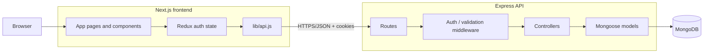
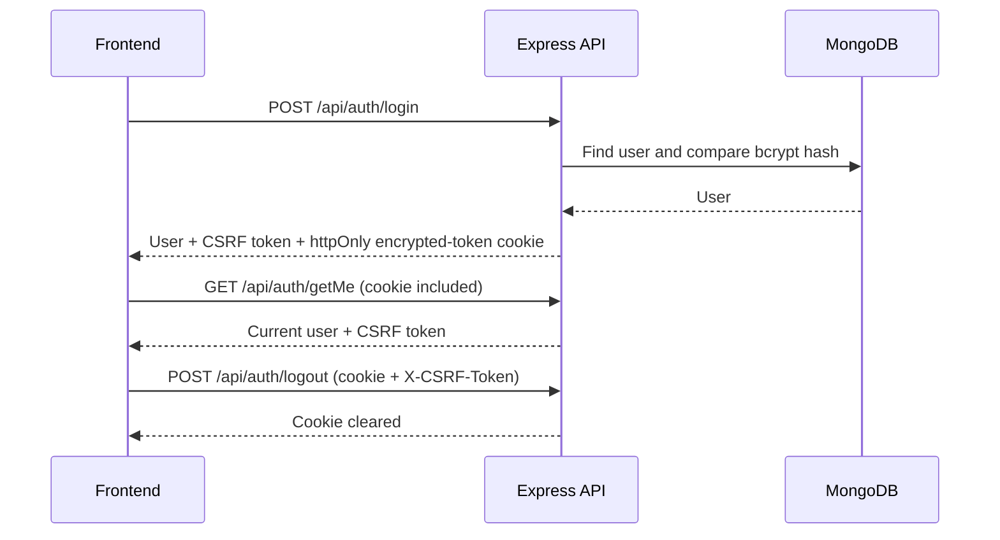
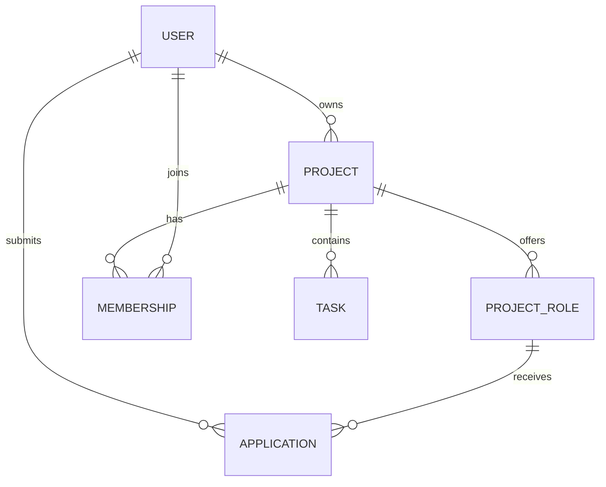

# GroupHub — System Architecture

**Scope:** architecture, APIs, data model, and algorithms only.  
**Status labels:** **Implemented** describes the current repository; **Proposed** is a design direction, not working code.

## 1. Architecture



- **Frontend:** Next.js App Router renders the UI. Redux is currently used only for authentication; page data is otherwise fixture data/local state.
- **Backend:** Express exposes REST endpoints. Only authentication endpoints are implemented today.
- **Database:** MongoDB is accessed through Mongoose. Only the `User` collection/schema exists today.

## 2. API communication

The frontend calls `NEXT_PUBLIC_API_URL` (default: `http://localhost:8762`) through `frontend/lib/api.js`. Requests use JSON and `credentials: 'include'`, allowing the browser to send the httpOnly session cookie.

### Implemented endpoints

| Method | Endpoint | Purpose | Auth |
| --- | --- | --- | --- |
| `POST` | `/api/auth/register` | Create a user after validation and password hashing. | No |
| `POST` | `/api/auth/login` | Verify credentials; set encrypted access-token cookie; return user and CSRF token. | No |
| `GET` | `/api/auth/getMe` | Restore the current session and return the current user. | Cookie |
| `POST` | `/api/auth/logout` | Validate CSRF token and clear the session cookie. | Cookie + CSRF |
| `GET` | `/api/auth/profile` | Confirm authentication and return the authenticated user ID. | Cookie |

### Authentication flow



The current session token is encrypted using `jose` with direct key management and `A256GCM`. It contains a user ID and a random CSRF token. Passwords are hashed with `bcryptjs` using 12 rounds.

## 3. Database schemas

### Implemented: `User`

```text
User
├── _id: ObjectId
├── name: String, required, trimmed
├── email: String, required, unique, lowercase, trimmed
├── password: String, required, excluded from normal queries
├── role: "user" | "admin" (default: "user")
├── createdAt: Date
└── updatedAt: Date
```

### Proposed: project domain

These collections do **not** exist in the present backend. They are the minimum model needed to replace the frontend fixtures.



| Proposed collection | Essential fields | Purpose |
| --- | --- | --- |
| `Project` | `ownerId`, `title`, `description`, `category`, `skills`, `stage`, `commitment`, `status` | The unit users discover and manage. |
| `ProjectRole` | `projectId`, `title`, `skills`, `slots`, `status` | An open role within a project. |
| `Application` | `projectId`, `projectRoleId`, `applicantId`, `message`, `status` | A request to join a project/role. |
| `Membership` | `projectId`, `userId`, `roleId`, `memberRole`, `status` | A confirmed project participant. |
| `Task` | `projectId`, `assigneeId`, `title`, `status`, `dueDate` | Work tracking after joining a team. |

## 4. Proposed API shape

These endpoints are suggested contracts; they are not implemented.

| Resource | Suggested endpoints |
| --- | --- |
| Profile | `GET/PATCH /api/users/me` |
| Projects | `GET/POST /api/projects`, `GET/PATCH/DELETE /api/projects/:projectId` |
| Roles | `POST/PATCH/DELETE /api/projects/:projectId/roles/:roleId` |
| Discovery | `GET /api/projects?query=&category=&skill=&stage=&page=` |
| Applications | `POST /api/project-roles/:roleId/applications`, `PATCH /api/applications/:applicationId` |
| Membership/tasks | `GET/POST /api/projects/:projectId/members`, `GET/POST/PATCH /api/projects/:projectId/tasks` |

All write operations should use the existing cookie session and CSRF-header pattern, validate request data, and verify ownership or membership before changing records.

## 5. Algorithms and rules

### Implemented

- **Credential validation:** required strings, normalized email, non-empty fields, and password length of at least eight characters.
- **Password protection:** bcrypt hash at registration; bcrypt comparison at login.
- **Session authorization:** decrypt cookie token, obtain `userId`, then load the current user for `getMe`.
- **CSRF check:** compare the request header token with the token inside the authenticated session.

### Proposed: project discovery and matching

No matching algorithm exists in the current backend. Start with transparent filters rather than claiming AI matching:

1. Filter open projects by category, stage, and required skills.
2. Rank exact skill intersections above partial intersections.
3. Prefer open roles with capacity and active project status.
4. Return paginated results with the matching role and skills visible.

An optional explainable score can be introduced later:

```text
score = 0.60 × skill_overlap + 0.25 × role_match + 0.15 × availability_match
```

Each input must be represented in the data model before this score is implemented. The current `User` schema has no skills or availability fields, so the score is intentionally only a future design.

## 6. Implementation order

1. Finish authenticated profile read/update and add validation/error handling.
2. Add `Project` and `ProjectRole`, then replace discovery fixtures with `GET /api/projects`.
3. Add applications and memberships with authorization rules.
4. Add tasks/dashboard aggregation after project membership is reliable.

