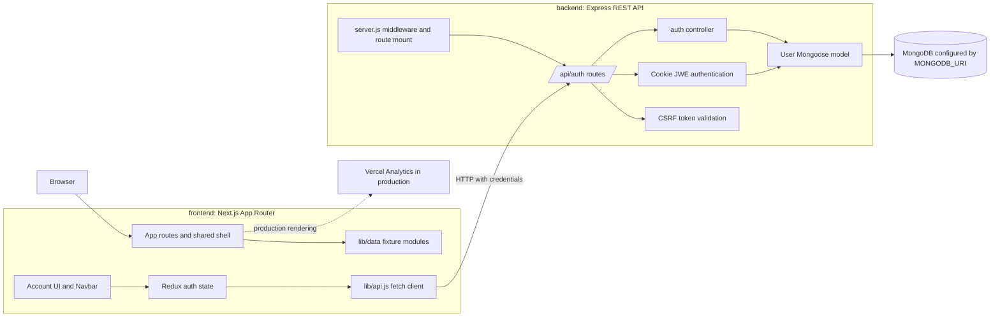
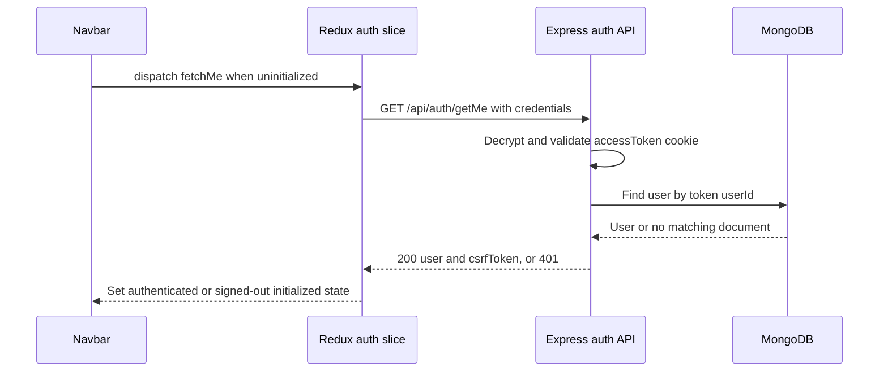

# GroupHub Project Architecture & Technical Overview

**Audience:** mentors, reviewers, and developers joining the project  
**Repository snapshot:** 15 October 2026  
**Scope:** current workspace source, package manifests and lockfiles, existing documentation, and Git history

## Reading this document

- **Verified** means directly visible in current source, configuration, manifests, or Git history.
- **Inference** means a conclusion supported by that evidence but not explicitly stated as a project-owner decision.
- **Recommendation** means proposed future work, not an existing commitment.

The current source is authoritative where older docs disagree. The working tree contains substantial uncommitted and untracked changes, including the current backend and frontend refactor. This document describes that workspace state; verify the relevant files are included in any clean checkout before relying on it as a release baseline.

## 1. Project overview

### Purpose and problem

**Verified:** GroupHub is presented as a project-first collaboration product for students, early-career professionals, and independent builders. Its stated problem is that people with project ideas have difficulty finding collaborators with complementary skills. The product concept makes open project roles, needed skills, stage, and commitment visible before a person joins a team.

**Proposed solution:** users discover projects by role and skill, then form teams around those opportunities. Profiles, a workspace, contribution history, tutorials, and reputation are part of the intended product experience.

**Current scope:** this repository currently provides a Next.js product UI and a small Express/MongoDB identity service. Persistent backend functionality is limited to account registration and cookie-based authentication/session lookup/logout. Project, team, application, contribution, tutorial, leaderboard, and contact content are not connected to backend persistence.

**Key differentiator (product intent):** role-first discovery, rather than a directory of projects or passive personal profiles. The UI demonstrates the idea, but matching scores and project opportunities are fixture values, not computed or live marketplace data.

| Concern                    | Current evidence                                                                                                     |
| -------------------------- | -------------------------------------------------------------------------------------------------------------------- |
| Target users               | Students, early-career professionals, and independent builders; described in the landing and About page copy.        |
| Intended product           | Discover open roles, find collaborators, and organize project work.                                                  |
| Working product capability | Registration, login, session restoration, and logout against MongoDB, subject to valid environment configuration.    |
| Prototype capability       | Project discovery, dashboard, profile editing, leaderboard, tutorials, and contact form are frontend-only or static. |

## 2. System architecture

### Topology

**Verified:** the repository contains two separately runnable packages. The browser renders the Next.js App Router frontend. Its auth client makes credentialed HTTP requests to the Express API. The API connects to MongoDB through Mongoose before it begins listening. No project-domain API, external identity provider, mail service, upload provider, or real-time service is configured in the current source.



### Communication and trust boundaries

| Boundary            | Current contract                                                                                                                                                             |
| ------------------- | ---------------------------------------------------------------------------------------------------------------------------------------------------------------------------- |
| Browser to frontend | Next.js routes; local fixture imports and React state drive most screens.                                                                                                    |
| Frontend to API     | `NEXT_PUBLIC_API_URL` or `http://localhost:8762`; `lib/api.js` sends JSON when a body exists, always uses `credentials: 'include'`, and optionally adds `X-CSRF-Token`.      |
| API to database     | Mongoose connection using `MONGODB_URI`; only the `User` model is present. The MongoDB hosting provider is not established by source.                                        |
| API CORS            | Credentialed CORS allows one configured origin: `FRONTEND_URL`, else `CLIENT_URL`, else `http://localhost:3000`.                                                             |
| Analytics / fonts   | `@vercel/analytics/next` is rendered in production. Geist fonts are imported through `next/font/google`; the source does not configure another external product integration. |

**Inference:** because the browser calls the API directly and the API sets a cookie, deployments must use a compatible frontend/API origin and cookie policy. Production cookies are `SameSite=None; Secure`, so production deployment requires HTTPS and matching CORS configuration.

## 3. Component responsibilities

### Backend

| Component                                                                                   | Receives / produces                                                         | Responsibility and interactions                                                                                                                                                |
| ------------------------------------------------------------------------------------------- | --------------------------------------------------------------------------- | ------------------------------------------------------------------------------------------------------------------------------------------------------------------------------ |
| [`backend/server.js`](../backend/server.js)                                                 | HTTP requests; starts the listener after DB connection                      | Loads dotenv, configures JSON parsing, request/response logging, CORS and cookie parsing, mounts `/api/auth`, and exposes `GET /` as a simple liveness string.                 |
| [`backend/config/db.js`](../backend/config/db.js)                                           | `MONGODB_URI`; Mongoose connection                                          | Opens the database connection. On failure, logs the error and exits the process; server startup therefore depends on MongoDB availability.                                     |
| [`backend/routes/auth.routes.js`](../backend/routes/auth.routes.js)                         | Auth HTTP requests; controller responses                                    | Defines registration, login, logout, current-user, and minimal authenticated profile routes; applies auth and CSRF middleware to logout and auth middleware to protected GETs. |
| [`backend/controllers/auth.controller.js`](../backend/controllers/auth.controller.js)       | Validated request values and `req.user`; JSON responses and cookie mutation | Registers users, verifies credentials, issues the encrypted session cookie, reads the current user, and clears the cookie on logout.                                           |
| [`backend/middleware/auth.middleware.js`](../backend/middleware/auth.middleware.js)         | `accessToken` cookie; `req.user`                                            | Decrypts the JWE using `JWT_ENCRYPTION_KEY`; rejects absent, invalid, or expired sessions with 401.                                                                            |
| [`backend/middleware/csrf.middleware.js`](../backend/middleware/csrf.middleware.js)         | `X-CSRF-Token` and authenticated token payload; continue or 403             | Compares the request header to the CSRF token embedded in the session. Currently attached only to logout.                                                                      |
| [`backend/models/User.model.js`](../backend/models/User.model.js)                           | User fields; MongoDB document                                               | Defines required trimmed name, normalized unique email, password excluded from normal queries, `user`/`admin` role, and timestamps.                                            |
| [`backend/controllers/profile.controller.js`](../backend/controllers/profile.controller.js) | None                                                                        | Empty file; no profile controller behavior exists.                                                                                                                             |
| [`backend/utils/endpoints.util.js`](../backend/utils/endpoints.util.js)                     | None                                                                        | Whitespace-only placeholder; no endpoint utility behavior exists.                                                                                                              |

### Frontend

| Component                                                                                                          | Receives / produces                                                    | Responsibility and interactions                                                                                                                                                                                |
| ------------------------------------------------------------------------------------------------------------------ | ---------------------------------------------------------------------- | -------------------------------------------------------------------------------------------------------------------------------------------------------------------------------------------------------------- |
| [`frontend/app/layout.jsx`](../frontend/app/layout.jsx)                                                            | Route children; root document                                          | Loads global CSS and Geist fonts, wraps the app in Redux, renders Navbar/Footer, and includes Vercel Analytics only for production.                                                                            |
| [`frontend/app/providers.jsx`](../frontend/app/providers.jsx), [`frontend/lib/store.js`](../frontend/lib/store.js) | React children; Redux context                                          | Expose a singleton Redux store whose only reducer is `auth`.                                                                                                                                                   |
| [`frontend/lib/api.js`](../frontend/lib/api.js)                                                                    | Endpoint payloads and optional CSRF token; parsed JSON or thrown error | Small browser `fetch` wrapper for the four auth calls. It is not a general API cache or server client.                                                                                                         |
| [`frontend/lib/features/auth/authSlice.js`](../frontend/lib/features/auth/authSlice.js)                            | Auth credentials / API results; auth state                             | Implements async registration, login, logout, and session lookup thunks. State includes `user`, `csrfToken`, request `status`, `initialized`, and `error`.                                                     |
| [`frontend/components/navbar.jsx`](../frontend/components/navbar.jsx)                                              | Pathname and Redux auth state; navigation UI                           | Starts `fetchMe()` on mount until auth is initialized; renders signed-in actions, global links, and mobile navigation.                                                                                         |
| [`frontend/app/account/page.jsx`](../frontend/app/account/page.jsx)                                                | User form values; auth thunk results                                   | Email/password registration and login UI. Registration returns to sign-in; successful login navigates to `/dashboard`. GitHub login is disabled and password recovery is a placeholder link.                   |
| [`frontend/app/profile/page.jsx`](../frontend/app/profile/page.jsx)                                                | Redux user; local editable values                                      | Displays session identity and an edit form. Save has no request or state update; profile is not persisted.                                                                                                     |
| [`frontend/app/find-projects/page.jsx`](../frontend/app/find-projects/page.jsx)                                    | `lib/data/find-projects.data.js`; local search/filter/bookmark state   | Filters fixture projects in memory. Bookmark, post, and view controls do not call the backend.                                                                                                                 |
| [`frontend/app/dashboard/page.jsx`](../frontend/app/dashboard/page.jsx)                                            | `lib/data/dashboard.data.js`; local modal visibility                   | Displays fixture stats, projects, applications, and activity. The create-project form has no submit implementation.                                                                                            |
| Other app routes                                                                                                   | Their corresponding `frontend/lib/data/*.js` modules                   | Home, About, Contribute, Leaderboard, and Tutorials render static/fixture content. Contact form only switches to local success state. Tutorial and leaderboard filter-looking controls have no state handlers. |
| [`frontend/components/`](../frontend/components)                                                                   | Page props and form events                                             | Small shared presentation helpers such as `Field`, `PageHeader`, `Section`, `Eyebrow`, `StatTile`, and `Avatar`; they do not provide persistence.                                                              |
| [`frontend/lib/data/`](../frontend/lib/data)                                                                       | Static JavaScript arrays/objects; UI content                           | Supplies demo records and copy, not a backend cache. Reloading discards local changes such as saved-project state.                                                                                             |

### Current API surface

All auth endpoints are mounted under `/api/auth`. The status codes below are directly represented in route/controller logic; database and unexpected errors can also affect actual responses.

| Method and path           | Access                    | Input / output                                                                    | Current behavior                                                                                                                                                                        |
| ------------------------- | ------------------------- | --------------------------------------------------------------------------------- | --------------------------------------------------------------------------------------------------------------------------------------------------------------------------------------- |
| `POST /api/auth/register` | Public                    | `{ name, email, password }` -> user summary                                       | Trims name/email, lowercases email, checks required string fields and minimum 8-character password, hashes with bcryptjs cost 12, creates user, returns 201. Does not create a session. |
| `POST /api/auth/login`    | Public                    | `{ email, password }` -> `{ message, user, csrfToken }` plus `accessToken` cookie | Normalizes email, compares password hash, encrypts a JWE session token, and sets the cookie.                                                                                            |
| `GET /api/auth/getMe`     | Auth cookie               | No body -> `{ user, csrfToken }`                                                  | Decrypts cookie, fetches user by ID, and returns the current identity.                                                                                                                  |
| `POST /api/auth/logout`   | Auth cookie + CSRF header | `X-CSRF-Token` -> success message                                                 | Authenticates and validates CSRF, then clears the cookie.                                                                                                                               |
| `GET /api/auth/profile`   | Auth cookie               | No body -> `{ message, userId }`                                                  | Authentication check only; does not read/update profile data.                                                                                                                           |
| `GET /`                   | No auth                   | No body -> text                                                                   | Simple backend-running response; server only listens after successful DB connection.                                                                                                    |

There are no current project, application, bookmark, dashboard, contact-message, leaderboard, tutorial-content, upload, or notification API endpoints.

## 4. End-to-end execution flows

### Registration

1. The account page collects name, email, password, and confirmation. The browser checks password confirmation.
2. Redux dispatches `registerUser`; `lib/api.js` posts JSON to `/api/auth/register` with cookies enabled.
3. The controller validates fields, normalizes email, hashes the password, and creates a `User` document.
4. The API returns 201 and a public user summary. No cookie or authenticated Redux state is created; the page switches to sign-in.


### Login

1. The account page dispatches `loginUser` with email and password.
2. The controller finds the normalized email and compares the supplied password with the stored bcryptjs hash.
3. On success it generates a random CSRF token, encrypts `{ userId, csrfToken }` as a JWE using `dir` and `A256GCM`, and sets an httpOnly `accessToken` cookie.
4. The API returns the user summary and CSRF token. Redux stores both in memory, and the page navigates to `/dashboard`.


### Session restoration

1. The Navbar mounts under the Redux provider. If `auth.initialized` is false, it dispatches `fetchMe()`.
2. `GET /api/auth/getMe` includes the browser cookie because the API client uses `credentials: 'include'`.
3. Authentication middleware decrypts the cookie and assigns its payload to `req.user`; the controller loads the user from MongoDB.
4. On success Redux restores `user` and `csrfToken`. On failure it clears those values and marks initialization complete, leaving the UI signed out.



### Logout

1. The Navbar dispatches `logoutUser()` and supplies Redux's CSRF token.
2. The API client posts to `/api/auth/logout` with the cookie and `X-CSRF-Token` header.
3. Auth middleware decrypts the cookie; CSRF middleware compares the header to the token payload.
4. The controller clears the cookie and returns 200. Redux clears the user and token and the UI navigates home. The rejected thunk path also clears frontend auth state, even if the server-side request failed.


### Current user-facing non-auth workflows

- **Find Projects:** imports fixture records, filters locally by title/description/category/skill/role, and toggles bookmarks in React state. No project details route, apply action, or persistence exists.
- **Dashboard:** displays fixture stats and activity. “New project” opens a local form, but submit is not handled. Several notification/settings actions are display-only.
- **Profile:** reads the session user from Redux; fields are locally editable, but Save has no handler/API call.
- **Contact:** submitting prevents the browser's normal form submission and displays a success message; no message is sent.
- **Other content pages:** static fixture data. Buttons such as tutorial Start and leaderboard period selectors do not currently alter content.

## 5. Technology stack and configuration

Versions below distinguish manifest declarations from exact versions recorded in the available npm locks. Current manifests and lockfiles are not fully aligned; see risks below.

| Layer                     | Technology                         | Version/evidence                                                        | Use in current source                           |
| ------------------------- | ---------------------------------- | ----------------------------------------------------------------------- | ----------------------------------------------- |
| Frontend framework        | Next.js                            | Manifest and npm lock: `16.2.4`                                         | App Router, rendering, dev/build/start scripts. |
| UI                        | React / React DOM                  | Manifest `^19`; lock `19.2.4`                                           | React components and client state.              |
| Styling                   | Tailwind CSS / PostCSS integration | Manifest `^4.2.0`; lock `4.2.0`                                         | Tailwind v4 CSS imports and utility classes.    |
| Shared state              | Redux Toolkit / React Redux        | Manifest `^2.13.0` / `^9.3.0`                                           | Auth state only.                                |
| Icons and classes         | lucide-react, clsx, tailwind-merge | `^0.564.0`, `^2.1.1`, `^3.3.1`                                          | Icons and class composition.                    |
| API runtime               | Node.js / Express                  | Node version not pinned; Express lock `5.2.1`                           | REST API and server middleware.                 |
| Persistence               | MongoDB / Mongoose                 | Provider/version of MongoDB unspecified; backend Mongoose lock `9.11.1` | User document storage and queries.              |
| Password/session security | bcryptjs / jose                    | Backend locks `3.0.3` / `6.2.12`                                        | Password hash and encrypted JWE session cookie. |
| HTTP support              | cors / cookie-parser / dotenv      | Backend locks `2.8.6` / `1.4.7` / `18.0.6`                              | CORS, request cookie access, env loading.       |
| Analytics                 | `@vercel/analytics`                | Frontend lock `1.6.1`                                                   | Production-only analytics component.            |
| Frontend CSS tooling      | `tw-animate-css`                   | Lock `1.3.3`                                                            | Imported by the active global stylesheet.       |

**Declared but not established as active behavior:** the frontend manifest includes libraries such as Radix UI, Better Auth, Express, Mongoose, React Hook Form, Zod, Recharts, and others. The current source paths inspected for this overview do not use most of those packages; dependency presence alone does not mean a feature is implemented. The backend also declares both `bcrypt` and `bcryptjs`, plus `jsonwebtoken`; current auth code imports `bcryptjs` and `jose`, not those alternatives.

### Environment variables

No secret values are included here. Create local environment files from the variable names and purposes below; no `.env.example` is present.

| Variable              | Consumer                                | Purpose / behavior                                                                                                                                         |
| --------------------- | --------------------------------------- | ---------------------------------------------------------------------------------------------------------------------------------------------------------- |
| `MONGODB_URI`         | Backend                                 | Required Mongoose connection string. API startup exits if connection fails.                                                                                |
| `PORT`                | Backend                                 | Listener port; defaults to `8762`. The startup log currently interpolates `process.env.PORT` directly, so it may print `undefined` when using the default. |
| `FRONTEND_URL`        | Backend                                 | Preferred allowed CORS origin when set.                                                                                                                    |
| `CLIENT_URL`          | Backend                                 | Fallback allowed origin when `FRONTEND_URL` is absent; final fallback is `http://localhost:3000`.                                                          |
| `JWT_ENCRYPTION_KEY`  | Backend                                 | Required base64-encoded 32-byte key for `A256GCM` JWE encryption/decryption. This is a secret; do not commit or publish its value.                         |
| `JWT_EXPIRES_IN`      | Backend                                 | JWE expiry expression accepted by `jose`; defaults to `15m`. Cookie `maxAge` is separately hard-coded to 15 minutes.                                       |
| `NEXT_PUBLIC_API_URL` | Frontend                                | Public API origin embedded for browser requests; defaults to `http://localhost:8762`.                                                                      |
| `NODE_ENV`            | Backend and frontend                    | Controls production cookie attributes and conditional Vercel Analytics.                                                                                    |
| `JWT_SECRET`          | Not used by current auth implementation | A stale/commented key name; current token code uses `JWT_ENCRYPTION_KEY`. Do not treat it as an active configuration requirement.                          |

### Configuration and integration notes

- Backend loads dotenv at startup through `import 'dotenv/config'`; frontend uses Next.js environment loading.
- The session is an encrypted JWT/JWE (`alg: dir`, `enc: A256GCM`), not a signed `jsonwebtoken` token.
- `accessToken` is httpOnly; development uses `SameSite=Lax`, production uses `SameSite=None; Secure`.
- The frontend's CSRF token is kept in Redux memory and recovered from `getMe` after reload.
- Analytics is the only explicitly integrated product service. There is no configured OAuth, email, AI, file-storage, or socket integration in the current source.

## 6. Development status

Status labels describe what exists in current source, not what appears on screen. “Implemented” means an end-to-end code path is present; it does not mean this workspace was runtime-tested for this document.

| Area                                                                | Status                          | Evidence / limitation                                                                                                  |
| ------------------------------------------------------------------- | ------------------------------- | ---------------------------------------------------------------------------------------------------------------------- |
| Next.js shell, navigation, responsive pages                         | **Implemented**                 | Routes and shared components render in source.                                                                         |
| Email/password account registration                                 | **Implemented**                 | UI calls backend; backend validates and persists a MongoDB user. Registration does not sign in automatically.          |
| Login, cookie session, session restore, logout                      | **Implemented**                 | UI thunks call implemented backend routes and middleware. Runtime success depends on valid env/database configuration. |
| Find Projects search and category/skill filtering                   | **UI-only**                     | Filters locally over `lib/data/find-projects.data.js`.                                                                 |
| Save/bookmark project                                               | **UI-only**                     | Browser memory only; reset on reload and not user-specific.                                                            |
| Dashboard and project-creation modal                                | **UI-only**                     | Fixture content; form has no submit handler and buttons are not backed by services.                                    |
| Profile display and edit form                                       | **UI-only**                     | Session identity is shown; save is not wired. Backend `/profile` only reports authenticated user ID.                   |
| Contact message form                                                | **UI-only**                     | Shows local success feedback; no request or delivery occurs.                                                           |
| About, Contribute, Leaderboard, Tutorials, home content             | **UI-only**                     | Static or fixture-backed presentation. Filter-looking controls are inert.                                              |
| Profile controller and endpoint utility                             | **Stub**                        | Controller empty; utility whitespace-only. The inline `GET /profile` is an auth check, not profile CRUD.               |
| Project, role, application, membership, task, bookmark APIs         | **Planned**                     | No corresponding current backend models/routes/controllers.                                                            |
| Real matching, leaderboard/reputation, notifications, tutorials CMS | **Planned**                     | Current output is static/demo data; no live service or domain persistence exists.                                      |
| In-progress work / blocked features                                 | **Unconfirmed / none verified** | No task tracker or source marker establishes active assignments or an external blocker.                                |

The account page's GitHub button is explicitly disabled and recovery link is a placeholder. The dashboard/profile routes are not protected by server middleware or a visible client route guard; displaying an auth-aware Navbar does not prevent signed-out access to those pages.

## 7. Team and ownership

**Verified from Git history:** all 62 commits represented by the current `git log --all` author-name query use the identity **Amandeep Singh**. `backend/package.json` also names “Aman” as its author. This establishes repository authorship, not a formal job title, current availability, or ownership agreement.

| Person / area                      | Verified information                                                                          | Unconfirmed information                                                                                       |
| ---------------------------------- | --------------------------------------------------------------------------------------------- | ------------------------------------------------------------------------------------------------------------- |
| Amandeep Singh (Aman)              | Author identity across observed Git history; backend package author field.                    | Formal role, current task list, review responsibilities, and ownership boundaries.                            |
| People shown in the About page     | Names and roles exist in fixture content.                                                     | Whether they are real contributors or current team members; do not treat page fixtures as ownership evidence. |
| Frontend/backend/product ownership | No ownership file, CODEOWNERS, or task assignment was identified in the inspected repository. | Individual module owners and dependencies between team members.                                               |

**Recommendation:** confirm contributors, current responsibilities, and module reviewers with the project owner before adding named ownership assignments. Git commit authorship can guide a conversation but is not a substitute for explicit ownership.

## 8. Design decisions and trade-offs

| Decision visible in source                                          | Benefit                                                                                       | Limitation / trade-off                                                                                                        |
| ------------------------------------------------------------------- | --------------------------------------------------------------------------------------------- | ----------------------------------------------------------------------------------------------------------------------------- |
| Separate `frontend/` and `backend/` packages                        | UI and API have independent scripts and deployment boundaries.                                | No root workspace/orchestration; developers start both processes manually.                                                    |
| Redux Toolkit for auth; page-local state for prototypes             | Shared identity is available to Navbar and profile while transient UI remains local.          | Auth state is memory-only; other interactions disappear on reload and cannot synchronize between devices.                     |
| httpOnly encrypted cookie rather than browser-readable access token | JavaScript cannot directly read the cookie; encrypted payload carries user ID and CSRF token. | Stateless sessions are not centrally revocable; cookie/CORS/CSRF behavior requires careful deployment setup.                  |
| CSRF token returned in response and required for logout             | Adds a header check for the current protected mutation.                                       | It is only attached to logout today; additional mutation endpoints must adopt a consistent check.                             |
| Fixture-first page implementation                                   | Allows product concepts and responsive UI to be presented before domain APIs exist.           | Demo values can be mistaken for live data; there is no persistence, matching algorithm, or real user content.                 |
| Lightweight custom presentation components and Tailwind utilities   | Fits current pages without a shared component-library dependency at runtime.                  | Older design-system docs describe a different shadcn/dark UI setup and should not guide current changes without confirmation. |
| Next config ignores TypeScript build errors                         | Allows current JS/JSX project build path to proceed without TS checks.                        | Type errors, if TypeScript is introduced, may be hidden; TypeScript is installed but source is primarily `.jsx`.              |

## 9. Current work, risks, and technical debt

### Verified repository and configuration issues

1. **Uncommitted source baseline:** current backend files and broad frontend changes are untracked or modified in this workspace. The latest observed commit is `3713614` (14 October 2026, “full codeBase refactor, creating backend from scratch”); the current files on disk may therefore not exist in a clean checkout at that commit.
2. **Multiple package-manager locks:** backend has npm and Bun lockfiles; frontend has npm, Bun, and pnpm lockfiles. The package manifests and npm locks are not fully aligned. Choose one package manager, reconcile dependencies, and verify installation from a clean checkout.
3. **No automated tests:** no current test suite was identified. Backend `npm test` is a placeholder that exits with an error. Frontend has a lint script, but ESLint is not declared as a direct dependency in the frontend manifest.
4. **Build checks are weakened:** `next.config.mjs` sets `typescript.ignoreBuildErrors: true`. There is no evidence here of a successful production build or API smoke test.
5. **No example environment template:** local env files are not documentation. A new developer needs database credentials and a locally generated JWE encryption key; no safe `.env.example` is present.
6. **Stale docs:** `frontend/README.md` says the project is frontend-only and has no auth/backend; `frontend/DOCUMENTATION-grouphub.md` describes an older UI/component setup. Both conflict with current source. The root `PROJECT_ARCHITECTURE_TECHNICAL_OVERVIEW.md` is another draft, not the maintained destination requested here.
7. **API configuration diagnostics:** `server.js` defaults the listener to 8762 but logs only the raw environment variable, so the message can be inaccurate. CORS accepts a single origin.

### Security and behavior risks

- Registration/login have field-type and empty checks, but no email-format validation, request throttling, or explicit rate-limit middleware is present. Registration responses distinguish an existing email (409), enabling account enumeration.
- Auth events log normalized email addresses. Avoid logging credentials or other sensitive request data; review operational retention and access to logs.
- `JWT_EXPIRES_IN` can differ from the fixed 15-minute cookie `maxAge`; keep them aligned or configure them from one value.
- Logout clears the browser cookie but does not revoke a copied token server-side. A token remains cryptographically valid until expiry if obtained elsewhere. Rejected logout also clears Redux state, which can leave a still-valid browser cookie to be restored on a later load.
- Password hashing uses bcryptjs cost 12, and passwords are excluded from default Mongoose projections. These are positive controls, but do not replace rate limiting, production configuration review, and security tests.
- No visible route authorization protects `/dashboard` or `/profile`; current pages can be opened while signed out and show fixture/empty identity states.
- No role-based authorization is implemented for the `admin` role. Do not infer admin capability from the schema enum.
- `jsonwebtoken` is imported but unused in auth source; `JWT_SECRET` is commented/unused. Remove or clarify these to avoid confusing future security changes.

### Historical context (not current capability)

Git history includes earlier commits titled around email verification, application/task email notifications, and AI project-description/tagging. The current route/model tree does not implement those features. Historical commits explain repository evolution only; they do not establish that those features are currently available or approved roadmap items.

## 10. Recommended roadmap

These are recommendations derived from observed gaps, not confirmed owner commitments.

| Priority | Milestone                                  | Expected outcome and completion criteria                                                                                                                                                                                                                      |
| -------- | ------------------------------------------ | ------------------------------------------------------------------------------------------------------------------------------------------------------------------------------------------------------------------------------------------------------------- |
| 1        | Reproducible baseline                      | Select npm or Bun, remove/reconcile competing lockfiles, align manifests, add `.env.example` with placeholders only, and document a supported Node version. A clean checkout installs and starts both apps using documented steps.                            |
| 2        | Auth regression and security baseline      | Add tests for registration validation/duplicates, login success/failure, session lookup/expiry, logout/CSRF, plus API rate limiting and centralized error handling. `npm test` (or chosen test command) exits successfully and security behavior is explicit. |
| 3        | Complete profile slice                     | Specify profile fields and authorization, implement authenticated read/update with validation, connect profile Save, and test persistence and forbidden/unauthenticated cases.                                                                                |
| 4        | Persist projects and discovery             | Define project/open-role schema and API, connect create/list/detail/search/filter/bookmark behavior, and replace fixture records. Reloaded sessions show persisted project data.                                                                              |
| 5        | Applications and team workflow             | Add application lifecycle, membership/role rules, and dashboard aggregation. A user can discover a real role, apply, and see an authorized status update.                                                                                                     |
| 6        | Production readiness and remaining domains | Define reputation/notifications/content requirements before implementing them; add monitoring, deployment checks, and security/accessibility review. Reintroduce historical features only after product scope is confirmed.                                   |

## 11. Getting started

### Prerequisites and configuration

**Verified:** no Node version is pinned in the package manifests, and no root-level package script orchestrates both applications. The backend requires a reachable MongoDB database and a valid encryption key.  
**Recommendation:** use a current Node.js LTS compatible with Next.js 16 and Mongoose 9; pin the selected version before onboarding additional contributors.

1. Create `backend/.env` with `MONGODB_URI`, `PORT=8762`, `FRONTEND_URL=http://localhost:3000`, `JWT_ENCRYPTION_KEY`, and optionally `JWT_EXPIRES_IN=15m`. The backend accepts `CLIENT_URL` as a fallback for `FRONTEND_URL`.
2. Generate a local 32-byte base64 key; keep the output private and do not commit it:

   ```sh
   openssl rand -base64 32
   ```

   Put that output in `JWT_ENCRYPTION_KEY` in the local backend env file. Do not reuse a checked-in or shared secret for production.

3. Create `frontend/.env.local` with `NEXT_PUBLIC_API_URL=http://localhost:8762` (or the actual API origin).
4. Ensure MongoDB is reachable at the configured URI. The API will exit before listening if its initial connection fails.

There are currently multiple lockfiles per package and they do not fully agree with manifests. `npm install` below is the available manifest-script path, but first-time installs may reconcile/update the npm lockfile. Do not run competing package managers against the same package until the repository selects a canonical manager.

### Install and run

Start each package in a separate terminal from the repository root:

```sh
cd backend
npm install
npm run dev
```

```sh
cd frontend
npm install
npm run dev
```

The backend defaults to `http://localhost:8762`; the frontend dev server defaults to `http://localhost:3000`. Visit the frontend origin. The backend root `GET /` returns a simple status string when the server is listening. The backend `npm start` runs `node server.js`; the frontend scripts are `npm run dev`, `npm run build`, `npm start`, and `npm run lint` as declared in their manifests. The backend test script is intentionally a failing placeholder, and the frontend lint command is not verified here.

### Useful local checks

- Test API readiness: request `GET http://localhost:8762/` after MongoDB connects.
- Exercise account registration and sign-in from `/account`; use a disposable local account.
- Check `frontend/package.json` and `backend/package.json` for the authoritative current script names.
- Do not commit local env files, secret values, or generated session tokens.

## Open questions for the project owner

1. Which package manager and lockfile should be canonical for each package?
2. What Node.js version and MongoDB deployment are supported for contributors and production?
3. Are the people listed on the About page current team members, or fixture data?
4. What project-domain slice should follow auth: profile, project creation/discovery, or applications?
5. Should the old feature set in Git history be reconsidered, or is any subset an approved roadmap?
